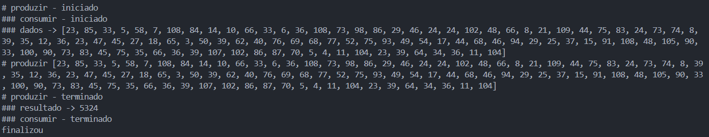
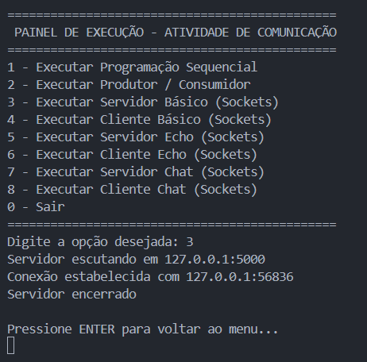
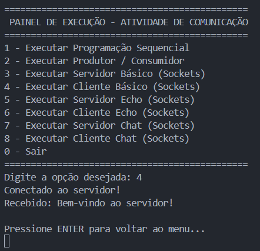

# Relatório sobre implementação de comunicação entre tarefas em C#

## Introdução

Este relato faz parte do processo avaliativo da disciplina de sistemas operacionas no curso superior em análise e desenvolvimento de sistemas, ofertado na Diretoria acadêmica de gestão e tecnologia da informação no campus natal-central do instituto federal de educação, ciência e tecnologia do rio grande do norte.

Tem como objetivo principal relatar as implementações de comunicação entre tarefas na linguagem C#.

O grupo de trabalho foi formado por Álvaro Luiz Barbalho de Souza Filho, Paulo Cesar Moreira da Silva, Pedro Messias Dias Neto.

## Comunicação entre tarefas em C#

### Informações gerais

A comunicação entre tarefas tem como objetivo permitir que diferentes fluxos de execução troquem dados e coordenem suas atividades durante a execução de um programa. 

Neste trabalho, foram abordadas três formas de comunicação: 
- Comunicação entre tarefas com linhas de execução no mesmo processo;
- Comunicação entre tarefas em processos diferentes no mesmo computador;
- Comunicação entre tarefas em processos diferentes em computadores diferentes.

Para a implementação foi utilizada a linguagem C#, com execução do projeto em containers Docker utilizando a imagem do .NET SDK 10. O Docker foi utilizado para fornecer um ambiente isolado e reproduzível para compilação e execução dos programas.

A configuração utilizada para execução foi baseada em um arquivo `Dockerfile`, responsável por copiar o projeto C# para o container, realizar sua compilação e executar a aplicação. O projeto também passou a contar com um menu interativo, permitindo selecionar as diferentes implementações desenvolvidas.

### Comunicação entre tarefas com linhas de execução no mesmo processo

Neste cenário, foi implementado em C# um modelo de comunicação entre tarefas utilizando threads, que compartilham a mesma área de memória do processo.

- Uma tarefa produz 100 números aleatórios e os armazena em uma lista compartilhada.
- Outra tarefa consome os números e calcula sua soma.
- A sincronização garante que os dados sejam produzidos antes de serem consumidos.

```csharp
using System;
using System.Linq;
using System.Threading;

namespace AtividadeComunicação
{
    public static class ProdutorConsumidor
    {
        private static int[] dados = new int[0];
        private static readonly Random random = new Random();

        public static void ProduzirDados()
        {
            Console.WriteLine("# produzir - iniciado");

            dados = new int[100];
            for (int i = 0; i < dados.Length; i++)
            {
                dados[i] = random.Next(0, 111);
            }

            Console.WriteLine($"# produzir [{string.Join(", ", dados)}]");
            Console.WriteLine("# produzir - terminado");
        }

        public static void ConsumirDados()
        {
            Console.WriteLine("### consumir - iniciado");
            Console.WriteLine($"### dados -> [{string.Join(", ", dados)}]");

            int resultado = dados.Sum();

            Console.WriteLine($"### resultado -> {resultado}");
            Console.WriteLine("### consumir - terminado");
        }

        public static void Principal()
        {
            Console.WriteLine("iniciou");

            Thread threadProdutor = new Thread(ProduzirDados);
            Thread threadConsumidor = new Thread(ConsumirDados);

            threadProdutor.Start();
            threadConsumidor.Start();

            threadProdutor.Join();
            threadConsumidor.Join();

            Console.WriteLine("finalizou");
        }
    }
}
```
### Execução e resultados
O programa foi executado em um contêiner Docker, utilizando a opção de programação Produtor/Consumidor.



O teste demonstrou a comunicação entre tarefas no mesmo processo por meio de memória compartilhada, com sincronização para garantir a ordem correta de execução.
### Comunicação entre tarefas em processos diferentes no mesmo computador

Nesta etapa, foram implementados exemplos de comunicação entre processos utilizando sockets TCP na linguagem C#. Diferentemente da comunicação entre threads, que compartilham a memória de um mesmo processo, os sockets permitem a troca de informações entre aplicações por meio de conexões de rede.

Foram utilizado o seguinte exemplo:

- Servidor/Cliente Básico: o servidor aguarda uma conexão e envia uma mensagem de boas-vindas ao cliente.

#### Servidor e Cliente Básico

A primeira implementação teve como objetivo estabelecer uma conexão TCP e realizar o envio de uma mensagem do servidor para o cliente.

**Servidor Básico (`ServidorBasico.cs`)**

```csharp
using System;
using System.Net;
using System.Net.Sockets;
using System.Text;

namespace AtividadeComunicação
{
    public static class ServidorBasico
    {
        public static void Principal()
        {
            // Obter o endereço IP configurado no ambiente
            // Se não existir, utilizar localhost
            string ip = Environment.GetEnvironmentVariable("SERVER_HOST")
                        ?? "127.0.0.1";

            IPAddress enderecoIP = IPAddress.Parse(ip);
            int porta = 5000;

            // Criar o servidor TCP
            TcpListener servidor = new TcpListener(enderecoIP, porta);

            try
            {
                // Iniciar a escuta por conexões
                servidor.Start();
                Console.WriteLine(
                    $"Servidor escutando em {enderecoIP}:{porta}"
                );

                // Aguardar conexão de um cliente
                TcpClient conexao = servidor.AcceptTcpClient();

                Console.WriteLine(
                    $"Conexão estabelecida com {conexao.Client.RemoteEndPoint}"
                );

                // Preparar a mensagem
                string mensagem = "Bem-vindo ao servidor!";
                byte[] dados = Encoding.UTF8.GetBytes(mensagem);

                // Enviar mensagem ao cliente
                using (NetworkStream stream = conexao.GetStream())
                {
                    stream.Write(dados, 0, dados.Length);
                }

                // Fechar a conexão
                conexao.Close();
            }
            catch (Exception ex)
            {
                Console.WriteLine(
                    $"Erro no servidor: {ex.Message}"
                );
            }
            finally
            {
                // Encerrar o servidor
                servidor.Stop();
                Console.WriteLine("Servidor encerrado");
            }
        }
    }
}
```
**Cliente Básico (`ClienteBasico.cs`)**
```csharp
using System;
using System.Net.Sockets;
using System.Text;

namespace AtividadeComunicação
{
    public static class ClienteBasico
    {
        public static void Principal()
        {
            // Obter o endereço do servidor pelo ambiente
            // Se não existir, utilizar localhost
            string ipServidor =
                Environment.GetEnvironmentVariable("SERVER_HOST")
                ?? "127.0.0.1";

            int porta = 5000;

            try
            {
                // Criar conexão com o servidor
                using (TcpClient cliente = new TcpClient(ipServidor, porta))
                {
                    Console.WriteLine("Conectado ao servidor!");

                    // Obter o fluxo de comunicação TCP
                    using (NetworkStream stream = cliente.GetStream())
                    {
                        // Preparar buffer para receber dados
                        byte[] buffer = new byte[1024];

                        // Receber mensagem do servidor
                        int bytesLidos = stream.Read(
                            buffer, 0, buffer.Length
                        );

                        // Converter os bytes recebidos em texto
                        string mensagem = Encoding.UTF8.GetString(
                            buffer, 0, bytesLidos
                        );

                        // Exibir mensagem recebida
                        Console.WriteLine($"Recebido: {mensagem}");
                    }
                }
            }
            catch (Exception ex)
            {
                Console.WriteLine(
                    $"Erro no cliente: {ex.Message}"
                );
            }
        }
    }
}
```

Durante a execução no Docker, foi possível observar que o servidor recebeu a conexão e que o cliente apresentou corretamente a mensagem enviada. Após a comunicação, a conexão foi encerrada.

### Execução e resultados
Os testes foram realizados utilizando dois terminais, um para o servidor e outro para o cliente.

    

Os resultados demonstraram o funcionamento da comunicação TCP/IP entre processos distintos no mesmo ambiente de execução.

### Comunicação entre tarefas em processos diferentes em computadores diferentes


Neste cenário, foi utilizada a comunicação por sockets TCP/IP entre dois contêineres Docker, simulando computadores distintos conectados por uma rede.

A implementação utiliza um Servidor Chat e um Cliente Chat, desenvolvidos em C#, que permitem a troca de mensagens entre processos independentes.

O Docker Compose foi utilizado para criar os contêineres e conectá-los por meio de uma rede virtual do tipo bridge.

**Servidor Chat (`ServidorChat.cs`)**
Trecho responsável por iniciar o servidor e aguardar a conexão do cliente:
```csharp
IPAddress enderecoIP = IPAddress.Parse(
    Environment.GetEnvironmentVariable("SERVER_HOST") ?? "127.0.0.1"
);

int porta = 5000;

TcpListener servidor = new TcpListener(enderecoIP, porta);

try
{
    servidor.Start();

    Console.WriteLine($"Servidor Chat a escutar em {enderecoIP}:{porta}");
    Console.WriteLine("A aguardar ligação do cliente...");

    TcpClient conexao = servidor.AcceptTcpClient();

    Console.WriteLine($"Cliente conectado: {conexao.Client.RemoteEndPoint}");
}
```
**Cliente Chat (`ClienteChat.cs`)**
```csharp
string ipServidor =
    Environment.GetEnvironmentVariable("SERVER_HOST") ?? "127.0.0.1";

int porta = 5000;

try
{
    TcpClient cliente = new TcpClient(ipServidor, porta);

    Console.WriteLine("Conectado ao Servidor Chat!");

    using (NetworkStream stream = cliente.GetStream())
    {
        Console.Write("Cliente: ");
        string? mensagem = Console.ReadLine();

        if (!string.IsNullOrEmpty(mensagem))
        {
            byte[] dados = Encoding.UTF8.GetBytes(mensagem);
            stream.Write(dados, 0, dados.Length);
        }
    }
}
```
### Execução e resultados
Os testes foram realizados no Docker Desktop, utilizando dois contêineres conectados à mesma rede virtual.

Durante a execução, o Cliente Chat conseguiu estabelecer uma conexão com o Servidor Chat e enviar a mensagem Olá servidor, recebida corretamente pelo servidor.

### Problemas e soluções

1. Erro na inicialização dos programas pelo Docker Compose
- Problema: o contêiner não conseguia executar corretamente a opção desejada do menu.
- Causa: configuração incorreta do comando de inicialização no docker-compose.yml.
- Solução: foi utilizado o entrypoint com dotnet run --no-build --, seguido do número 

2. Falha na conexão entre cliente e servidor
- Problema: o Cliente Chat apresentava o erro Connection refused.
- Causa: o endereço 127.0.0.1 apontava para o próprio contêiner, e não para o servidor.
- Solução: foram utilizadas variáveis de ambiente (SERVER_HOST) para configurar os endereços do servidor e do cliente.

3. Dificuldade para encerrar contêineres Docker
- Problema: alguns comandos de parada e remoção dos contêineres não respondiam.
- Causa: o Docker Desktop apresentou problemas de resposta durante a execução.
- Solução: o Docker Desktop foi reiniciado e os contêineres foram posteriormente encerrados utilizando docker compose down.
## Considerações finais 

A atividade permitiu implementar e testar diferentes formas de comunicação entre tarefas utilizando a linguagem C# e o ambiente Docker.

Na primeira parte, foi explorada a comunicação entre threads pertencentes ao mesmo processo, utilizando o modelo produtor-consumidor. Essa implementação permitiu observar o compartilhamento de dados e compreender melhor o funcionamento dos métodos `Start()` e `Join()`.

Na segunda parte, foram desenvolvidas implementações de comunicação entre processos utilizando sockets TCP, por meio dos exemplos Básico, Echo e Chat. Os testes permitiram observar o estabelecimento de conexões, o envio e recebimento de mensagens e o encerramento da comunicação.

A implementação do Chat também demonstrou como uma conexão pode ser mantida durante várias trocas de mensagens, permitindo uma interação entre cliente e servidor.

Além dos conceitos de comunicação entre tarefas, a atividade contribuiu para o aprendizado sobre a utilização do Docker como ambiente de execução e sobre a organização de aplicações C# que utilizam recursos de rede.